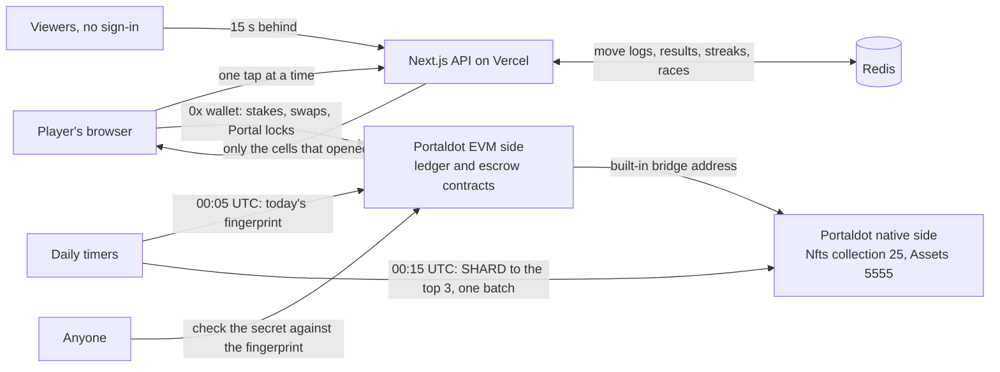

# Portalsweeper: a daily Minesweeper for 500 Portal NFTs on Portaldot V3

Portalsweeper is a daily puzzle game on the **Portaldot V3 testnet**.
There are 500 Portals. Each one gets its own Minesweeper board every day, its traits change the rules, and clearing the board reveals the Portal's art.
The three fastest clears of the daily Challenge win SHARD, a token on Portaldot's Assets module. 100 SHARD buys a Portal, minted to you as a native NFT, and the 100 SHARD are burned.

> **Can you clear today's board fastest?**

Live: **https://portalsweeper.vercel.app**

Demo video (2 min): **https://youtu.be/VoFko5kYYdk**

392 tests in 48 files run on every push (see the Actions tab). MIT licensed.

Built for [Portaldot Hacker House 2026](https://dorahacks.io/hackathon/portaldot-hacker-house-2026), Ecosystem DApps track.

## Check it in one minute

No wallet and no sign-up for any of these.

| Open this | What you'll see |
|---|---|
| [/chain](https://portalsweeper.vercel.app/chain) | Every Portaldot feature the game uses, read from the chain when you open the page, plus a list of real transactions. Click any hash to open its block in the Portaldot node console |
| [/judge](https://portalsweeper.vercel.app/judge) | Type 9 and play a Legendary Portal: 14 by 14, 30 mines, and its stone frame takes one hit for you |
| [/verify](https://portalsweeper.vercel.app/verify) | Pick a past day and a Portal. Your browser asks Portaldot for that morning's fingerprint, rebuilds the board and says match or mismatch |
| [/live](https://portalsweeper.vercel.app/live) | Games being played right now, 15 seconds behind, with a viewer count |

## What you can do

| Feature | How it works | Portaldot part |
|---|---|---|
| Daily board | Every Portal has a new board each UTC day. Practice is unlimited and needs no wallet | |
| Challenge of the Day | One shared Portal each day. One ranked try per wallet, timed by the server. 1st, 2nd and 3rd win 10, 4 and 2 SHARD, all paid in one chain action | Assets, Utility batch, System remark, ledger contract |
| Redeem a Portal | Sign a free message, and one chain action takes 100 SHARD from you, burns it, mints the Portal to you with its traits and leaves a note. All or nothing | Assets, Nfts, Utility batch |
| Race a friend | Send a link, both play the same hidden board, the faster clear wins | |
| Stake tPOT on a race | Both players lock the same amount in an escrow contract (up to 1 tPOT). Win pays the pot, a draw refunds both | EVM contract (pallet-revive) |
| Stake a Portal on a race | Each player locks one Portal from their normal 0x wallet. The winner gets both in one action | Nfts called from an EVM wallet |
| Watch live | A player ticks "Broadcast my game". Anyone can watch with no sign-in, 15 seconds behind, with a viewer count. Mines are never sent while the game runs | Identity (player names) |
| Back a player | On a race page (/event/[id]), viewers put up to 0.5 tPOT on one of the two players. The two players cannot back. Backers of the winner split the pot, paid in one action. A cancelled race refunds everyone | Utility batch, Identity |
| Buy a Portal | Three Portals (#398, #399 and #400) are for sale at a price that follows the SHARD pool, about 6.52 tPOT now. The sale uses the chain's own shop (`nfts.setPrice` and `nfts.buyItem`), so no contract is involved. /money shows the live price board | Nfts |

Daily rule: SHARD goes only to the top 3 of the Challenge of the Day. Nobody gets a free Portal for a win. Friend races, practice, the daily Portal boards and streaks pay no SHARD, because two wallets could farm them.

## How it uses Portaldot

Portaldot V3 runs an EVM side and a native side on one chain. Portalsweeper uses both, and a normal 0x wallet reaches the native modules directly.

| Portaldot feature | What Portalsweeper does with it |
|---|---|
| Nfts (native NFT module) | The 500 Portals live in collection 25. Each mint carries the Portal's name, image link and traits on chain. Portal swaps, pre-signed mints and Portal stakes all use it |
| Assets (native token module) | SHARD is asset 5555, no contract needed. The chain also shows it as a normal ERC-20 at `0x000015b300000000000000000000000000010000`. A SHARD and tPOT trading pool is open |
| Utility batch | One all-or-nothing action for the award (mint, traits, SHARD, note), the daily SHARD prizes, a redeem, a Portal stake payout and a backing payout |
| Identity | The game's own account is named "Portalsweeper". Player names set in Identity show on /live and on backing pages |
| System remark | A short note on chain for each award, redeem and payout, with the winner's move log fingerprint |
| EVM side (pallet-revive) | Two Solidity contracts: the stake escrow and the daily ledger. Wallets connect and sign here |
| EVM plus native | A normal 0x wallet calls Nfts through the chain's built-in bridge address, so swaps, pre-signed mints and Portal stakes need no second wallet. A Portal minted to a player lands on the native account Portaldot links to their 0x wallet |
| Chain random number | Each day's board mixes in a number from Portaldot's block producers, read after the fingerprint is posted. On from 5 Nov |

Why native modules and not more contracts: on this testnet a contract locks about 0.06 tPOT per byte of code. A small ERC-721 would lock hundreds of tPOT. A native NFT mint locks about 0.1 tPOT.

## Proof you can check

Every row is a real transaction on the Portaldot V3 testnet, read back from the chain before it was listed. The same list is on **/chain**, and the money side is on **/money**. Each link opens the block in the Portaldot node console.

| What happened | Portaldot feature | Hash | Block |
|---|---|---|---|
| Stake contract put on the chain | EVM contract | `0x490eabae…301da1` | [326760][b326760] |
| Stake match won: the contract paid the winner | EVM contract | `0xdb681400…a5eec1` | [327257][b327257] |
| Stake match drawn: the contract refunded both players | EVM contract | `0x86c39476…dceabb` | [327267][b327267] |
| First daily fingerprint written to the ledger contract | EVM contract | `0x74f8c3de…c207b1` | [327450][b327450] |
| A wallet on the EVM side calling a native chain feature in one step | EVM plus native | `0xcf5201a2…3d3279` | [326771][b326771] |
| Daily note written with the System Remark call | System | `0x166121e0…120b3f` | [326933][b326933] |
| A replay file stored on the chain (Transaction Storage) | Transaction Storage | `0x10e3e225…d1eaba` | [326969][b326969] |
| Identity name "Portalsweeper" set | Identity | `0x30c1b98f…7439f4` | [332052][b332052] |
| Portal collection 25 created (block hash) | Nfts | `0x9d64e6e9…a452ba` | [332042][b332042] |
| SHARD token (asset 5555) created (block hash) | Assets | `0xeeda778f…ff9e7c` | [332048][b332048] |
| Portal #102 minted to a player with its name, image and traits | Nfts | `0xca1af6cb…374ad9` | [332827][b332827] |
| SHARD trading pool opened (5 tPOT and 90 SHARD) | Assets pool | `0xabe2dbb4…dab405` | [332885][b332885] |
| One action: mint Portal #103, write 3 traits, issue SHARD, leave a note (rehearsal to a team wallet) | Utility batch | `0xebf6729c…bef94f` | [332941][b332941] |
| Portal swap offered from a normal 0x wallet | Nfts from EVM | `0x04f14ae2…4a9b21` | [332984][b332984] |
| Portal swap accepted by the other wallet | Nfts from EVM | `0x6a7642db…524b8f` | [332995][b332995] |
| Portal #104 minted from a pre-signed order | Nfts from EVM | `0x1506a9b4…adaf84` | [333041][b333041] |
| Player A sets a chain name from a normal 0x wallet | Identity from EVM | `0xe702eb82…fda116` | [334681][b334681] |
| Player B sets a chain name from a normal 0x wallet | Identity from EVM | `0x60da17df…765b48` | [334682][b334682] |
| Portal stake: player locks a Portal in escrow | Nfts from EVM | `0xbaf0b075…0b36d3` | [333468][b333468] |
| Portal stake: second player locks a Portal | Nfts from EVM | `0x776b2b31…6e39b2` | [333470][b333470] |
| Portal stake: winner receives both Portals in one action | Utility batch, Nfts | `0xed5b9b77…02c34b` | [333472][b333472] |
| Daily SHARD prizes for 1st, 2nd and 3rd paid in one action (test day) | Utility batch, Assets | `0x6fdfdfa7…9ce6f8` | [333404][b333404] |
| Redeem: 100 SHARD burned and Portal #477 minted in one action | Utility batch, Assets, Nfts | `0xf3460a82…4ecbc7` | [333419][b333419] |
| Backing pool: winners' backers paid in one action (test coins) | Utility batch | `0x66e0f1b1…7ab4aa` | [333620][b333620] |
| Backing pool with a 5% treasury cut: winner paid, cut sent to the treasury and a note listing pot, cut and share, all in one action (test coins) | Utility batch | `0x40a46343…297422` | [335236][b335236] |
| Backing pool: cancelled event refunded in one action (test coins) | Utility batch | `0x333d40ac…95914f` | [333623][b333623] |
| Portal sale: Player B bought Portal #398 from the treasury through the chain's built-in shop for 6.52 tPOT, new owner read back from the chain | Nfts | `0xd2878f0c…2f7c7f` | [339731][b339731] |

Full hashes are in `lib/chainProof.ts`, and raw records of the runs are in `proof/`. All of these were run by our own test wallets. The node console shows blocks, so open the block and find the hash in it.

## For the judges

| What the rubric asks | Where to see it |
|---|---|
| Technical Feasibility | The live site, the 26 transactions above, 392 tests on every push, and /verify, which checks any past day against Portaldot from your own browser |
| Innovation, effective use of V3 | Nfts, Assets, Utility batch, Identity, System remark and two EVM contracts, with a normal 0x wallet reaching the native modules directly (table above) |
| Ecosystem Contribution | The daily ledger contract works for any game that fixes a secret before play: a word game, a card deal, a raffle. Guide in [`docs/portaldot.md`](docs/portaldot.md), MIT licensed |
| Business Potential | How Portalsweeper makes money, above, and the live counts on /money. Everything runs on testnet coins |

## How a board works

You open a Portal's board for today. It changes at midnight UTC. For the Challenge of the Day each wallet gets its own board, so watching someone else play tells you nothing about yours.

Under the tiles sits the Portal's own artwork. Each tile you clear opens a little window onto it. Clear them all and you see the whole Portal.

During a ranked try the mines stay on the server. Each tap is sent there, checked against the real board, and only the cells it opens come back. The server's clock times you, so nobody can send in a made-up time.

## Traits change the rules

Every Portal has eight traits (Tier, Gate, Rift, Core, Frame, Sigil, Pattern, Realm). Four of them change how the board plays, and every rule that fires shows up on screen with the reason.

| Trait | What it does | Portals it applies to |
|---|---|---|
| Tier | Sets the board size. Common 8 by 8 with 10 mines, up to Legendary 14 by 14 with 30 | All 500 |
| Core | A bright core lights one safe tile before you start. Prism, Starlight and Solar also keep the tiles around it clear | 268 of 500 |
| Frame | A solid frame (stone, iron, brass, obsidian) takes one hit for you | 267 of 500 |
| Sigil | Any sigil flags one real mine for you | 56 of 500 |

Board sizes: 307 Portals play 8 by 8, 147 play 9 by 9, 25 play 10 by 10, 15 play 12 by 12 and 6 play 14 by 14.

The seeded script rebuilds the same Portal traits and artisan assignments. Portraits are generated and layered from the source pictures in `public/artisans`, so those files are needed to reproduce the artwork. The current set has one source picture for each of ten trades. The patterns include Adire and Kente.

## Fairness you can check yourself

A daily puzzle is only fun if nobody can change the board after seeing who played. So each day works like a sealed envelope:

1. **Morning:** the site makes a secret for the day and posts only its fingerprint on Portaldot. It is also written to the ledger contract. The fingerprint matches that one secret and no other.
2. **During the day:** the secret stays hidden. Later, a random number from the chain is mixed in, so we could not have picked a board we liked.
3. **After the day ends:** the secret is published. Anyone can check it against the morning's fingerprint, then rebuild any board and compare. /verify does this in your browser and asks Portaldot directly.

What this proves: the boards were fixed before anyone played and were not changed afterwards.

Which Portal is featured can be worked out by anyone: `keccak256("portal-of-the-day:DATE:FINGERPRINT") mod 500 + 1`, stepping past Portals already owned and the Portal featured the day before. From 5 Nov it also steps past Portals 401 to 500, which are kept for SHARD redeems.

## Architecture



## How Portalsweeper makes money

People pay for the thing they want to own (a Portal), sponsors pay for attention (a sponsored day), and I keep a small cut when people back a player in a race. Nobody pays just to play. Everything below runs on testnet coins with no value, and every number on [/money](https://portalsweeper.vercel.app/money) is either a real count read from Portaldot or a labelled example with its inputs written next to it.

| Money line | How it works | State today |
|---|---|---|
| Pool cut | When a backing pool pays out, 5% of the pot goes to a treasury wallet in the same chain action as the winners. The note on chain lists the pot, the cut and every backer's share. Refunds take nothing. Only pools opened after the deploy carry the cut | Live in tPOT on testnet. A paid pool with the cut ran at block [335236][b335236] |
| Portals | There are 500 Portals and no more will be made. The loop is SHARD only: the Challenge of the Day top 3 earn 10, 4 and 2 SHARD, and 100 SHARD is burned to redeem a Portal, so every redeem takes SHARD out for good | The redeem runs on chain (Portal #477, block [333419][b333419]). A mainnet price is not set |
| Portal sale | Three Portals (#398 to #400) can be bought straight from the treasury with the chain's built-in shop. The price follows the SHARD pool (about 6.52 tPOT now), so a Portal costs what its SHARD is worth. /money shows the price board | A real purchase ran on chain (Portal #398, block [339731][b339731]) |
| Sponsored days | A project pays the day's prize plus a fee and gets its name on the board | Planned, not built |

SHARD is only ever earned by finishing in the top 3 of a one-try ranked day, so there is nothing to farm for turning up. /money also shows a made-up example of how the three lines add up, labelled as an example and not a forecast.

Real money is a different question. Staking real value on a game with any luck in it is regulated in many places, and Minesweeper sometimes forces a guess. So the plan for mainnet starts with free-entry sponsored days, takes legal advice country by country, and only allows real stakes where they are clearly legal.

## What you have to trust

| Part | Who you trust | Plain status |
|---|---|---|
| Fingerprint posted before play | Nobody | On chain with a block time, cannot be changed |
| Secret checked against the fingerprint | Nobody | Your browser does it on /verify, and the ledger contract refuses a wrong secret |
| Chain random number | The testnet's 2 block producers | One could nudge it. It still arrives after the fingerprint, so we cannot pick it |
| The secret during the day | Our server | It holds the secret while the day runs |
| Who won a race or the Challenge | Our server, as referee | It names the winner. The move log fingerprint in each note lets anyone check that claim |
| tPOT race stakes | The escrow contract, plus our server as referee | The contract can only pay one of the two players or refund both |
| Portal stakes and backing pots | Our server's escrow wallet | Trusted custody: the server holds staked Portals and pooled tPOT until the race ends |
| The coins | Nobody, there is nothing to lose | Testnet only. tPOT has no value |

## What this is not

- **Not real money.** Portaldot V3 is a testnet and tPOT has no value. Every stake, pot and prize uses test coins.
- **Not trustless.** Our server is the referee and holds staked Portals and backing pots. Only tPOT race stakes sit in a contract.
- **Not farm-proof.** One ranked try per wallet, not per person. Someone with many wallets can still farm SHARD. Planned fix: require an Identity name or 3 days of ranked history before paying.
- **Not many Portals yet.** 4 of 500 exist (#102, #103, #104 and #477), all minted by our own test runs. Nobody outside the team has won or redeemed one yet.
- **Not real players yet.** So far the top clear on 5 Nov is one of our own test wallets. 5 Nov is the first day the SHARD prize rule runs, and its payout goes out at 00:15 UTC on 6 Nov.
- **Not click-tested by a person with a browser wallet.** The screens for stakes, redeem, backing and live watching were run and checked with scripts against the live chain, not yet clicked through by hand.
- **No swap button in the game.** The SHARD pool, Portal swaps and pre-signed mints were run by script. The game screens do not offer them yet.
- **The fairness check has a limit.** It proves boards were not changed after play, not that our server never saw the secret.
- **Records live on a free database.** Fine for now, not built for a big crowd.

## Portaldot testnet deployment

| What | Value |
|---|---|
| Network | Portaldot V3 testnet, `wss://test-node-v3.portaldot.dev`. EVM side chain id 420420777, RPC `https://test-evm-rpc-v3.portaldot.dev` |
| Portal collection | Nfts collection **25**, max 500, only the issuer can mint |
| SHARD | Assets asset **5555**, 0 decimals. ERC-20 view at `0x000015b300000000000000000000000000010000` |
| Stake escrow contract | `0x9cebe7c313b0c86c55d956a3d07bd191fddabf9a`. Opening a staked race needs about 9 tPOT free and joining about 5, because the chain keeps a storage fee |
| Daily ledger contract | `0xf815869398505e795566f329f0867c0e5304145c`, 1883 bytes of code. Source in `contracts/DailyLedger.sol` |
| Fingerprint poster wallet | `0x6cE5b32C1747442ff480DC1ce60a2b229CCa0F82`. First fingerprint written to the ledger contract at [block 327450][b327450] |
| Identity | The game's account is named "Portalsweeper" |

## Development log

| Date | What changed |
|---|---|
| 2026-10-19 to 22 | Built Chogsweeper on Monad, the game this one grew from ([repo](https://github.com/Sireadell/chogsweeper)) |
| 2026-10-22 | Moved the game to Portaldot V3. Made the 500 Portals and their trait rules. Kept today's mines on the server. Started posting a daily fingerprint |
| 2026-10-23 | Demo video, pitch deck and architecture diagram |
| 2026-11-01 | Friend races, and tPOT stakes on them |
| 2026-11-04 | Deployed the ledger contract. First real stake runs on Portaldot. Tests, type checks and a build on every push |
| 2026-11-05 | Stake escrow contract (win paid, draw refunded). Portal collection 25 with names, images and traits on chain. SHARD as asset 5555 with a trading pool. One-action award. Portal swaps and a pre-signed mint from a normal 0x wallet. Identity name. Chain random number switched on. Daily SHARD prizes, redeem 100 SHARD for a Portal, Portal stakes on races, live watching and backing a player |

## Where this came from

Portalsweeper is a remix of my own game, [Chogsweeper](https://github.com/Sireadell/chogsweeper) (October 2026), which ran on Monad for an existing NFT collection. For Portaldot I replaced the collection with 500 generated Portals, moved the fingerprints to Portaldot, and built the Portal, SHARD and race features on Portaldot's native modules.

## Run it locally

You need [Node.js](https://nodejs.org) 22 or newer and [Git](https://git-scm.com).

```bash
git clone https://github.com/Sireadell/portalsweeper.git
cd portalsweeper
npm install
npm run dev      # a local secret is created for you the first time
```

Then open http://localhost:3000.

Run the tests:

```bash
npm test
```

Redraw the 500 Portals (same result every time):

```bash
node scripts/gen-portals.mjs
node scripts/build-wall-mosaic.mjs
```

Preview a day's fingerprint post without sending anything:

```bash
npx tsx scripts/post-commit.ts --dry-run
```

### Server settings (hosted)

| Variable | What it is |
|---|---|
| `PORTAL_SALT_SECRET` | Long random value; the daily secrets are made from it |
| `POSTER_PRIVATE_KEY` | Key of the small EVM wallet that posts the daily fingerprint |
| `ISSUER_MNEMONIC` | Key of the native account that owns the Portal collection and SHARD, and sends awards and redeems |
| `PORTAL_COLLECTION_ID`, `NEXT_PUBLIC_PORTAL_COLLECTION_ID` | The Nfts collection id (25) |
| `SHARD_ASSET_ID` | The SHARD asset id (5555) |
| `ESCROW_CONTRACT_ADDRESS`, `ESCROW_PRIVATE_KEY`, `NEXT_PUBLIC_STAKES` | The stake escrow contract, the referee and custody wallet's key, and `1` to switch stakes on |
| `RANDOM_FROM` | First day that mixes in the chain random number |
| `CRON_SECRET` | Protects the daily timers |
| `REDIS_URL` (Vercel Redis), or `UPSTASH_REDIS_REST_URL` + `UPSTASH_REDIS_REST_TOKEN` | Records store. One of the two is required on a hosted site |

Nothing secret is ever written in this repo.

## Built with

| Part | Role |
|---|---|
| Portaldot V3 testnet | Nfts, Assets, Utility batch, Identity, System remark, and two contracts on the EVM side |
| Next.js, viem and @polkadot/api | The site, the EVM calls and the native calls |
| Redis (Vercel Redis on the live site; Upstash also works) | Records, streaks, races, broadcasts and backing |
| Vercel | Hosting and the daily timers |

> **Can you clear today's board fastest?**

[b326760]: https://node-console.portaldot.dev/?rpc=wss%3A%2F%2Ftest-node-v3.portaldot.dev#/explorer/query/326760
[b327257]: https://node-console.portaldot.dev/?rpc=wss%3A%2F%2Ftest-node-v3.portaldot.dev#/explorer/query/327257
[b327267]: https://node-console.portaldot.dev/?rpc=wss%3A%2F%2Ftest-node-v3.portaldot.dev#/explorer/query/327267
[b327450]: https://node-console.portaldot.dev/?rpc=wss%3A%2F%2Ftest-node-v3.portaldot.dev#/explorer/query/327450
[b326771]: https://node-console.portaldot.dev/?rpc=wss%3A%2F%2Ftest-node-v3.portaldot.dev#/explorer/query/326771
[b326933]: https://node-console.portaldot.dev/?rpc=wss%3A%2F%2Ftest-node-v3.portaldot.dev#/explorer/query/326933
[b326969]: https://node-console.portaldot.dev/?rpc=wss%3A%2F%2Ftest-node-v3.portaldot.dev#/explorer/query/326969
[b332052]: https://node-console.portaldot.dev/?rpc=wss%3A%2F%2Ftest-node-v3.portaldot.dev#/explorer/query/332052
[b332042]: https://node-console.portaldot.dev/?rpc=wss%3A%2F%2Ftest-node-v3.portaldot.dev#/explorer/query/332042
[b332048]: https://node-console.portaldot.dev/?rpc=wss%3A%2F%2Ftest-node-v3.portaldot.dev#/explorer/query/332048
[b332827]: https://node-console.portaldot.dev/?rpc=wss%3A%2F%2Ftest-node-v3.portaldot.dev#/explorer/query/332827
[b332885]: https://node-console.portaldot.dev/?rpc=wss%3A%2F%2Ftest-node-v3.portaldot.dev#/explorer/query/332885
[b332941]: https://node-console.portaldot.dev/?rpc=wss%3A%2F%2Ftest-node-v3.portaldot.dev#/explorer/query/332941
[b332984]: https://node-console.portaldot.dev/?rpc=wss%3A%2F%2Ftest-node-v3.portaldot.dev#/explorer/query/332984
[b332995]: https://node-console.portaldot.dev/?rpc=wss%3A%2F%2Ftest-node-v3.portaldot.dev#/explorer/query/332995
[b333041]: https://node-console.portaldot.dev/?rpc=wss%3A%2F%2Ftest-node-v3.portaldot.dev#/explorer/query/333041
[b334681]: https://node-console.portaldot.dev/?rpc=wss%3A%2F%2Ftest-node-v3.portaldot.dev#/explorer/query/334681
[b334682]: https://node-console.portaldot.dev/?rpc=wss%3A%2F%2Ftest-node-v3.portaldot.dev#/explorer/query/334682
[b333468]: https://node-console.portaldot.dev/?rpc=wss%3A%2F%2Ftest-node-v3.portaldot.dev#/explorer/query/333468
[b333470]: https://node-console.portaldot.dev/?rpc=wss%3A%2F%2Ftest-node-v3.portaldot.dev#/explorer/query/333470
[b333472]: https://node-console.portaldot.dev/?rpc=wss%3A%2F%2Ftest-node-v3.portaldot.dev#/explorer/query/333472
[b333404]: https://node-console.portaldot.dev/?rpc=wss%3A%2F%2Ftest-node-v3.portaldot.dev#/explorer/query/333404
[b333419]: https://node-console.portaldot.dev/?rpc=wss%3A%2F%2Ftest-node-v3.portaldot.dev#/explorer/query/333419
[b333620]: https://node-console.portaldot.dev/?rpc=wss%3A%2F%2Ftest-node-v3.portaldot.dev#/explorer/query/333620
[b335236]: https://node-console.portaldot.dev/?rpc=wss%3A%2F%2Ftest-node-v3.portaldot.dev#/explorer/query/335236
[b333623]: https://node-console.portaldot.dev/?rpc=wss%3A%2F%2Ftest-node-v3.portaldot.dev#/explorer/query/333623
[b339731]: https://node-console.portaldot.dev/?rpc=wss%3A%2F%2Ftest-node-v3.portaldot.dev#/explorer/query/339731
