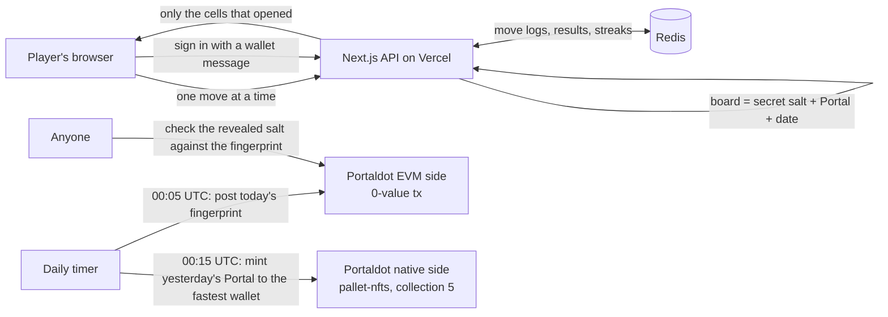

# Portalsweeper: a daily minesweeper where the Portal is the board, and winning it makes it yours

Portalsweeper is a daily puzzle game on **Portaldot V3**.
There are 500 Portals. Each one gets its own minesweeper board every day, its traits change the rules, and clearing the board reveals the Portal's art.
Every day one unclaimed Portal is the **Portal of the day**. Anyone can take one ranked try, and the fastest clear **wins that Portal as a native NFT on Portaldot**.

> **Can you win today's Portal?**

Live: **https://portalsweeper.vercel.app**

Built for [Portaldot Hacker House 2026](https://dorahacks.io/hackathon/portaldot-hacker-house-2026), Ecosystem DApps track.

## Try it in one minute, no wallet

1. Open **/judge**
2. Type any Portal number from 1 to 500 (try 9, a Legendary).
3. Read the rule cards, then play. Tap to open a tile. To flag, right-click, or turn on Flag mode on a phone.
4. Clear the board and the Portal's art appears.

Want more? **/practice** gives unlimited boards, and every win chains into the next Portal.

## How a board works

You open a Portal's board for today. It is the same board for everyone who opens that Portal today, and it changes at midnight UTC.

Under the tiles sits the Portal's own artwork. Each tile you clear opens a little window onto it. Clear them all and you see the whole Portal.

## Traits change the rules

Every Portal has eight traits (Tier, Gate, Rift, Core, Frame, Sigil, Pattern, Realm). Four of them change how the board plays, and every rule that fires shows up on screen with the reason.

| Trait | What it does | Portals it applies to |
|---|---|---|
| Tier | Sets the board size. Common 8 by 8 with 10 mines, up to Legendary 14 by 14 with 30 | All 500 |
| Core | A bright core lights one safe tile before you start. Prism, Starlight and Solar also keep the tiles around it clear | 268 of 500 |
| Frame | A solid frame (stone, iron, brass, obsidian) takes one hit for you | 267 of 500 |
| Sigil | Any sigil flags one real mine for you | 56 of 500 |

Board sizes: 307 Portals play 8 by 8, 147 play 9 by 9, 25 play 10 by 10, 15 play 12 by 12 and 6 play 14 by 14.

The Portals are drawn by `scripts/gen-portals.mjs`, a seeded generator, so anyone can rebuild the exact same 500 Portals from the code. The patterns include Adire and Kente.

## Win the Portal of the day

1. Each UTC day, one unclaimed Portal is featured.
2. Connect any wallet and sign a message (no gas, no transaction) to take your one ranked try. The mines stay on the server: each tap is sent there, checked against the real board, and only the cells it opens come back. The server's clock times you from your first tap to your last move. A refresh picks the try back up; the clock keeps running.
3. Just after midnight UTC, the fastest clear wins. The Portal is minted to the winner with Portaldot's native NFT pallet (`pallet-nfts`).
4. The NFT goes to the native account that Portaldot links to your 0x wallet, so it shows up for that wallet with no extra setup.

Which Portal is featured can be worked out by anyone: `keccak256("portal-of-the-day:DATE:FINGERPRINT") mod 500 + 1`, stepping forward past Portals already won and the Portal featured the day before.

## Fairness you can check yourself

A daily puzzle is only fun if nobody can change the board after seeing who played. So each day works like a sealed envelope:

1. **Morning:** the site makes a secret for the day and posts only its fingerprint on Portaldot. The fingerprint is a short code that matches that one secret and no other.
2. **During the day:** the secret stays hidden, so nobody can work out where the mines are.
3. **After the day ends:** the secret is published. Anyone can check it matches the fingerprint posted that morning, then rebuild any Portal's board and compare.

Check a past day at **/verify**. It takes about a minute: pick a day and a Portal, and the page shows match or mismatch. Your browser asks Portaldot directly, so the answer does not rely on our server.

What this proves: the boards were fixed before anyone played and were not changed afterwards.
What it does not prove: the site itself can see the secret during the day.

## How it uses Portaldot

Portaldot V3 runs two sides on one chain, and Portalsweeper uses both:

| Side | What Portalsweeper does there |
|---|---|
| EVM side (pallet-revive, chain id 420420777) | The daily fingerprint post: a 0 value transaction with the fingerprint as its data. Your wallet connects and signs here |
| Native side (pallet-nfts) | The Portal collection. Each Portal of the day winner gets a real native NFT |
| The link between them | pallet-revive maps an 0x wallet to the native account `0x… ++ 0xEE × 12`. Portalsweeper mints to that account, so the 0x wallet owns the Portal |

Why native NFTs and not a Solidity contract: on the V3 testnet a contract locks a storage deposit of about 0.06 tPOT per byte of code (`revive.depositPerByte`). A small ERC-721 would lock hundreds of tPOT. A native NFT mint locks about 0.1 tPOT (`nfts.itemDeposit`).

### Architecture



The mines never leave the server while a game is running. The server replays the move log on the real board, keeps the clock, and records the result itself, so a player cannot send in a made-up score.

### On-chain record so far

| What | Where |
|---|---|
| First fingerprint post, 2026-10-22 | EVM tx `0xbdab89b89b034f57296e912129cc45b093eb5403e4682dbfa3f23791bd01b872`, [block 148888](https://node-console.portaldot.dev/?rpc=wss%3A%2F%2Ftest-node-v3.portaldot.dev#/explorer/query/148888) |
| Fingerprint poster wallet | `0x6cE5b32C1747442ff480DC1ce60a2b229CCa0F82` |
| Portal collection (pallet-nfts) | Collection id **5**, created in block [`0x56619eef…eb6fd5`](https://node-console.portaldot.dev/?rpc=wss%3A%2F%2Ftest-node-v3.portaldot.dev#/explorer/query/0x56619eef26eb975273e0edfe5bef0b6337a288a4ae23c53818b3d83ed0eb6fd5). Max 500, issuer-only mint |
| Collection issuer (native) | `5GxegAnxmYtA8EQXCCuSy5KTJu7fLsR6THtXpx7bw3P6yeqc` |

## Status at check-in (Oct 24)

Done:
- Live game: daily board for each of the 500 Portals, trait rules, shareable results, streaks
- Portal of the day with one ranked try per wallet; every move checked on the server
- Portal collection created on Portaldot V3 (pallet-nfts, collection id 5)
- Daily fingerprint posted on the Portaldot EVM side, and a page to check it

Still to do before Nov 6:
- **PvP:** challenge a friend by link, both play the same board, and the faster clear wins
- **Stakes:** put up tPOT or a Portal NFT on a PvP match; the winner takes the pot
- First real Portal of the day award minted to a winner (the timer runs at 00:15 UTC)
- More testing and polish on the live site
- Demo video

## Reasons to come back

| Feature | What it is |
|---|---|
| Daily board | One board per Portal per day. Its record and streak belong to the Portal, so they stay with it if it changes hands |
| Portal of the day | One shared board for everyone. One ranked try per wallet. Fastest clear wins the Portal as an NFT |
| My Portals | Connect the wallet that holds your Portals. Each one gets a ranked board every day |
| Streaks | Current and best streak, with a "clear today to keep it" reminder |
| Reveal wall | All 500 Portals, filling in with art as players clear them |
| Hall | Today's top 10 and yesterday's winner |
| Share card | A picture of the revealed Portal with the board size, time, date and that day's fingerprint |
| Practice | Unlimited unranked boards for any Portal, no wallet |

## What this is not

- **One try per wallet, not per person.** Today's mines never reach the browser and the server keeps the time, so nobody can read the board or report a fake time. But someone with many wallets still gets many tries.
- **The fairness check has a limit.** It proves boards were not changed afterwards, not that the site never saw the secret.
- **No Portal has been won yet.** The award flow is tested (see `lib/award.test.ts`), but the first real mint happens after the first day with a winner.
- **The Portals are my own design.** The art and the trait rules come from the generator in this repo.
- **Records live on a free database.** That is fine for now, but it is not built for a large crowd.
- **Testnet only.** Portaldot V3 is a testnet, and tPOT has no value.

## Where this came from

Portalsweeper is a remix of my own game, [Chogsweeper](https://github.com/Sireadell/chogsweeper) (October 2026), which ran on Monad for an existing NFT collection. For Portaldot I replaced the NFT collection with 500 generated Portals, moved the fingerprint posts to Portaldot, dropped the paid Daily Pot and the token hint, and added the win-the-Portal flow on Portaldot's native NFT pallet.

## Run it locally

You need [Node.js](https://nodejs.org) 22 or newer and [Git](https://git-scm.com).

```bash
git clone https://github.com/Sireadell/portalsweeper.git
cd portalsweeper
npm install
npm run dev      # a local secret is created for you the first time
```

Then open http://localhost:3000.

Run the tests:

```bash
npm test
```

Redraw the 500 Portals (same result every time):

```bash
node scripts/gen-portals.mjs
node scripts/build-wall-mosaic.mjs
```

Preview a day's fingerprint post without sending anything:

```bash
npx tsx scripts/post-commit.ts --dry-run
```

### Server settings (hosted)

| Variable | What it is |
|---|---|
| `PORTAL_SALT_SECRET` | Long random value; the daily secrets are made from it |
| `POSTER_PRIVATE_KEY` | Key of the small EVM wallet that posts the daily fingerprint |
| `ISSUER_MNEMONIC` | Key of the native account that owns the Portal collection and mints the winners' Portals |
| `PORTAL_COLLECTION_ID`, `NEXT_PUBLIC_PORTAL_COLLECTION_ID` | The pallet-nfts collection id |
| `CRON_SECRET` | Protects the two daily timers |
| `REDIS_URL` (Vercel Redis), or `UPSTASH_REDIS_REST_URL` + `UPSTASH_REDIS_REST_TOKEN` | Records store. One of the two is required on a hosted site |

Nothing secret is ever written in this repo.

## Built with

| Part | Role |
|---|---|
| Portaldot V3 testnet | Daily fingerprints (EVM side) and the Portal NFTs (native pallet-nfts) |
| Next.js, viem and @polkadot/api | The site, the EVM reads and the native NFT calls |
| Upstash Redis | Records, streaks, the wall, Portal of the day and claims |
| Vercel | Hosting and the two daily timers |
